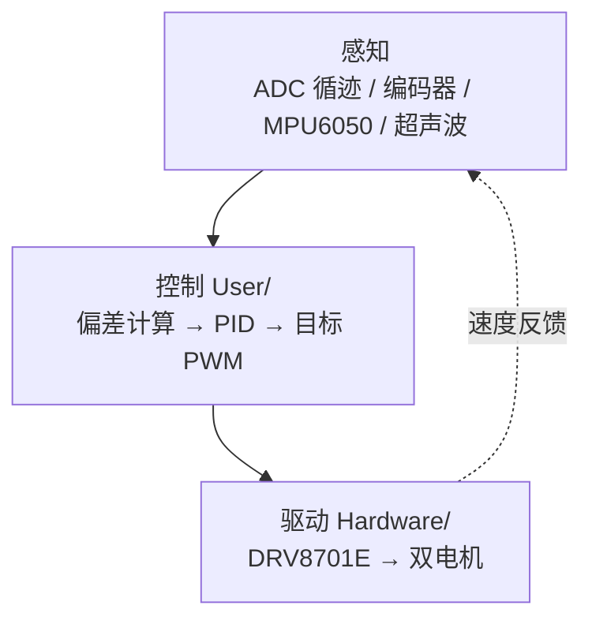

# 2025 信达杯 · STM32 智能车

基于 STM32F103C8T6 的智能车控制系统：双电机差速、编码器测速、PID 闭环、多路循迹与姿态感知。分层模块化，各功能独立封装。

> 这是比赛完赛版本，代码里保留了现场调试状态。**接手前请先读 [KNOWN_ISSUES.md](KNOWN_ISSUES.md)** —— 尤其是"速度闭环实际是开环"和"控制周期与文档不一致"两条。

## 参数

| 项目 | 参数 |
| --- | --- |
| 主控 | STM32F103C8T6 @ 72 MHz |
| 电机驱动 | DRV8701E，PWM PA8 / PA11 |
| 方向控制 | PB12 / PB13 |
| 编码器 | TIM3 (PB4/PB5)、TIM4 (PB6/PB7) |
| 姿态 | MPU6050，I2C 400 kHz |
| PWM | 17 kHz，ARR = 999（占空比 0–1000） |
| 通信 | UART 115200 bps |

## 架构



> 虚线的速度反馈目前是断开的：编码器未接入，反馈固定为 0。详见 `KNOWN_ISSUES.md`。

## 目录

```
├── Hardware/      自研模块：mt_motor / mt_pid / mt_encoder / mt_mpu6050
│                  mt_state_machine / mt_track_detect / mt_ultrasonic
│                  mt_vofa / mt_mode_control / OLED / LED / Key
├── Library/       ST 标准外设库（未改动）
├── Start/         启动文件与 CMSIS（未改动）
├── System/        Delay / pwm_config
├── User/          main.c、中断服务
└── Project.uvprojx
```

## 文档

| 文档 | 内容 |
| --- | --- |
| [技术报告.md](技术报告.md) | 系统架构、算法实现与控制策略 |
| [GPIO_Pin_Summary.md](GPIO_Pin_Summary.md) | 全部 GPIO 引脚配置汇总 |
| [KNOWN_ISSUES.md](KNOWN_ISSUES.md) | 调试残留、已知偏差与恢复步骤 |

## 编译

Keil MDK 打开 `Project.uvprojx`，确认 Target 与调试器（J-Link / ST-Link）后 Build。`keilkill.bat` 可清理编译中间文件。

## 接线注意

`GPIO_Pin_Summary.md` 中 PA0 同时登记为"左电机控制 A 相"与"ADC 赛道传感器"，PA1–PA5 也有类似复用。接线以该表为准，不要按各模块单独文档拼接。

---

## 归档整理说明

本次只做不改变控制行为的清理：

- `Buzzer_Tone()` 增加除零保护
- `LIMIT` 宏改为 `static inline` 函数，消除参数重复求值风险
- 死区 `+= 0` 空操作改为命名常量 `MOTOR_DEAD_ZONE`
- `Motor_Turn()` 增加 PWM 越界保护
- 基础速度提成宏，清理 `【修改】` 类临时注释，统一缩进

所有 PID 参数、控制律、状态机、引脚分配、中断配置均未改动。逐项对照见 `KNOWN_ISSUES.md`。
